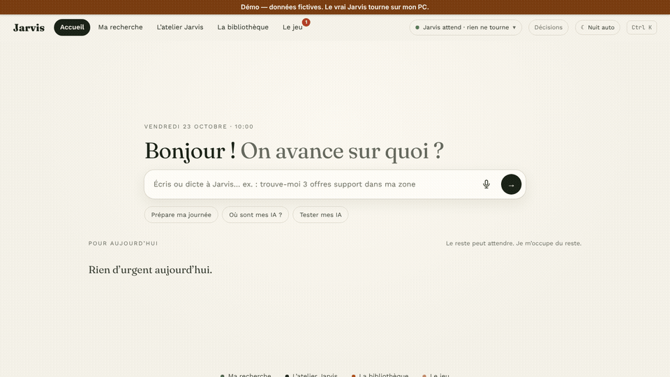
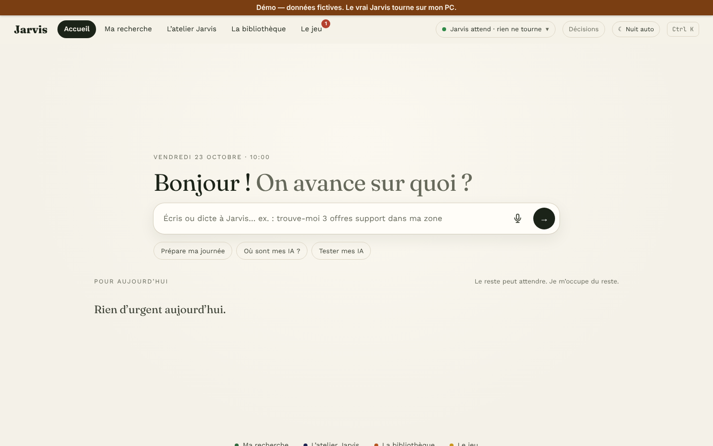
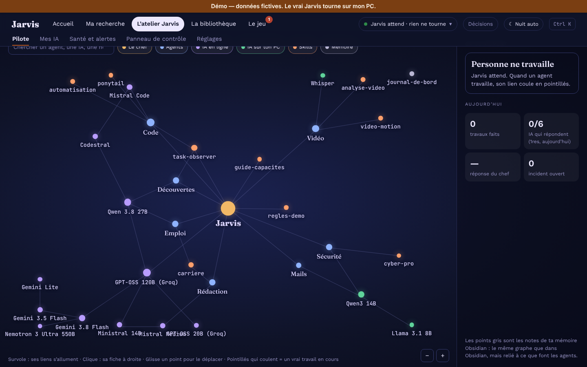
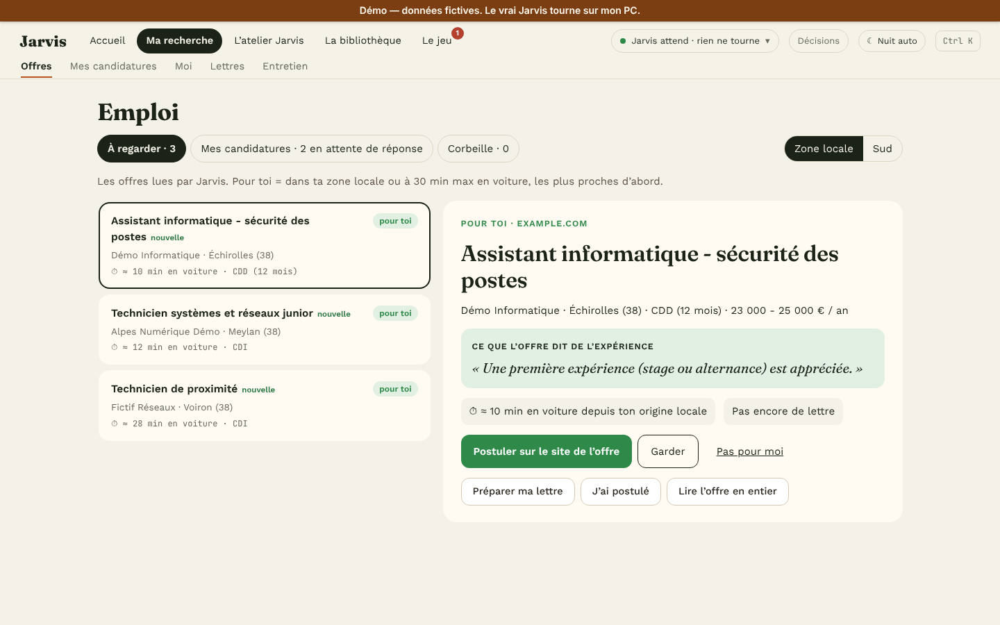
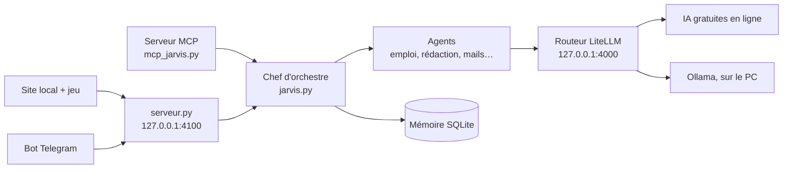

# Jarvis

Jarvis — mon assistant IA multi-agents, qui tourne sur mon PC et ne fait rien sans mon clic.

**[Essayer la démo](https://jessim-noui.github.io/jarvis)** (données fictives) · Vidéo de 3 min : bientôt

| Accueil | Pilote (les agents) | Emploi (offres vérifiées) |
|---|---|---|
|  |  |  |

## Ce que ça fait

- **Un chef d'orchestre et des agents** : le chef comprend la demande et la confie au bon agent (emploi, rédaction, code, mails, sécurité, veille, vidéo). Les questions simples sont réglées par le code, sans IA.
- **Un routeur d'IA gratuit** (LiteLLM) : une seule adresse locale pour plusieurs IA gratuites en ligne et une IA sur le PC (Ollama). Si une IA tombe ou n'a plus de quota, il passe à la suivante.
- **Un site local** (offres d'emploi vérifiées, lettres, santé des IA, journal, réglages) et **un petit jeu en pixel art** qui sert d'accueil.
- **Telegram et dictée** : je peux lui écrire depuis mon téléphone (bot privé), ou lui parler (Whisper tourne sur le PC).
- **Le tri des offres** : l'IA doit citer la phrase de l'annonce sur l'expérience, et le code vérifie que cette phrase existe vraiment.
- **L'ange gardien de la mémoire** (`jarvis/outils/gardien_memoire.py`) : il vérifie la mémoire du PC toutes les 5 s. À 80 %, il note qui la prend et vide l'IA locale. À 90 % pendant 10 s, il ferme l'IA locale puis Jarvis et me prévient. Il ne ferme jamais le jeu, Chrome ni Discord.

## Comment c'est construit

## Des résultats mesurés

- **Banc d'essai de 15 questions** (mission 16) : avant, 4 bonnes réponses sur 15 en 63,6 s ; après, 15 sur 15 en 0,05 s (temps médian). Source : `outils/banc_essai.py`.
- **Tests** : lancer `cd jarvis` puis `py -3 -m unittest discover -s tests`. Certains tests de serveur ont besoin d'ouvrir un port local.

## La sécurité

- **Un texte du web ou d'un mail est une donnée, jamais un ordre** : il est encadré avant d'aller à une IA (`securite.encadrer`), et les motifs d'injection sont bloqués.
- **Liste blanche + clic humain** : une action réelle (envoyer, appliquer) passe seulement par `securite.executer`, qui exige un clic sur la page, dans le jeu ou un bouton Telegram. Une IA ne peut pas l'appeler.
- **Les clés ne sont jamais dans le code** : elles sont lues dans `secrets/` (hors de git), et toute valeur de clé est masquée avant d'aller dans un prompt ou un journal (`securite.masquer_secrets`).
- **Données personnelles** : la démo GitHub Pages utilise uniquement `docs/demo-data/`, avec des exemples fictifs, et désactive les actions. Le serveur de l'application locale écoute sur `127.0.0.1`; les questions générales peuvent toutefois être envoyées aux fournisseurs d'IA configurés. Le profil, les souvenirs et les résumés de conversation ne sont pas joints au contexte des modèles en ligne. La génération de lettres et l'entraînement d'entretien utilisent uniquement le profil local et le modèle local `jarvis-prive`.
- **Données d'emploi** : les offres affichées par l'application locale proviennent des sources configurées et peuvent inclure les critères de recherche de l'utilisateur. La démo publiée ne contacte pas ces sources et n'affiche que des annonces d'exemple à liens `example.com`.

## Ce que j'ai appris

- Mesurer avant d'optimiser : le banc d'essai a montré où partait le temps.
- Vérifier une IA avec du code : si elle cite une phrase, le code contrôle qu'elle existe.
- Prévoir un retour arrière pour chaque changement (sauvegardes, bouton « Annuler »).
- Publier avec un historique neuf : une clé était restée dans l'ancien historique (elle a été changée depuis).

## Lancer chez soi

1. Python 3 (testé avec 3.14), puis `pip install -r requirements.txt`.
2. Copier `routeur-ia/routeur/config.example.yaml` en `config.yaml`.
3. Créer le dossier `secrets/` et y mettre `cles.env` (une ligne `NOM=valeur` par clé : `GROQ_API_KEY`, `GEMINI_API_KEY`, `LITELLM_MASTER_KEY`…). Un autre dossier est possible avec la variable `JARVIS_SECRETS`.
4. Double-cliquer sur `JARVIS.bat`.

Sans dossier `jarvis/donnees/`, Jarvis utilise les données fictives de `jarvis/donnees.exemple/` (ou le dossier donné par `JARVIS_DONNEES`).

## Limites

- Windows seulement (lanceurs `.bat` et PowerShell, notifications Windows).
- Les IA gratuites ont des quotas qui changent : certaines réponses peuvent être lentes ou passer par une autre IA.
- C'est un projet personnel, pas un produit.

---

Conçu et piloté par moi ; code écrit avec l'aide d'un assistant IA, relu, testé et compris.

Licence MIT — voir [LICENSE](LICENSE).
